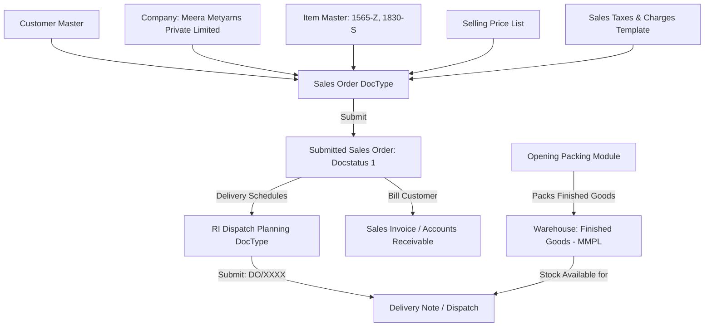

# ERP Automation Framework — Persistent Business Context & Project Memory

> **System:** Frappe Framework / ERPNext (Frappe Cloud: `https://meera-qc.m.frappe.cloud`)  
> **Company:** Meera Metyarns Private Limited (MMPL)  
> **Domain:** Textile & Metallic Yarn Manufacturing  
> **Framework:** Playwright (TypeScript) + Component Object Model + Page Object Model  
> **Status:** Living Document — Continuously maintained across test automation lifecycles  
> **Last Updated:** October 2026  

---

## 1. Business Overview

### 1.1 Purpose of the ERP System
The ERP system manages manufacturing, inventory, order processing, quality verification, and dispatch operations for **Meera Metyarns Private Limited (MMPL)**, a textile enterprise specializing in metallic yarn and yarn processing. The platform is built on top of the **Frappe Framework / ERPNext** platform (`/desk` interface).

### 1.2 Core Modules Identified
1. **Opening Packing / Yarn Packing (`/desk/opening-packing`):**
   - Core production/packaging milestone where finished yarn bobbins (cops) are weighed, assigned batch numbers, labeled, and inventoried into finished goods warehouses.
2. **Sales Order / Order-to-Cash (`/desk/sales-order` or `/app/sales-order`):**
   - Commercial customer contract committing to supply yarn products at negotiated rates, quantities (in Kgs/Cops), delivery schedules, and payment/tax terms.
3. **Stock & Warehouse Management (`/desk/stock-entry`, `/desk/warehouse`):**
   - Movement of materials into warehouses (e.g., `Finished Goods - MMPL`).
   - Batch tracking (`batch_no`) and inventory valuation based on net weight.
4. **RI Dispatch Planning (`/desk/ri-dispatch-planning`):**
   - Downstream order fulfillment module connecting customer Sales Orders with warehouse dispatch planning. Queries pending delivery schedules, assigns plan quantities and shipping addresses, and produces approved Delivery Orders (`DO/XXXX`).
5. **Master Data Management:**
   - Companies (`Company` master: e.g., "Meera Metyarns Private Limited").
   - Warehouses (`Warehouse` master: e.g., "Finished Goods - MMPL").
   - Customers (`Customer` master: wholesale buyers, agents, export clients).
   - Finished Items (`Item` master: e.g., "1565-Z", "1830-S", "2951-250/1").
   - Employees / Operators (`Employee` or `User` master: e.g., "GAJANAN SANTOSH NIWALKAR").
   - Packaging attributes (e.g., `tube_color` representing bobbin tube colors).

---

## 2. Business Workflows

### 2.1 Workflow: Opening Packing Transaction (End-to-End)

```
[Prerequisites Met]
       │
       ▼
1. Header Data Entry ────────► Series, Company, Date, Posting Time, Checker, Packer, Warehouse
       │
       ▼
2. Item & Packaging Entry ───► Finish Item, Tube Color, COPS (Bobbins count)
       │
       ▼
3. Weight Capture ───────────► Enter Gross Wt & Tare Wt
       │
       ▼
4. Dynamic Calculation ──────► System auto-computes: Net Wt = Gross Wt - Tare Wt
       │
       ▼
5. Validation Gate ──────────► Is Net Wt > 0? Is COPS provided?
       ├─ NO  ──────► Show Modal Error ("Please enter a Net Wt", "Please enter a COPS")
       └─ YES ──────► Click "+ Add"
                           │
                           ▼
6. Barcode Print Trigger ────► Opens Print View tab for yarn cone label / barcode
       │                       (Test closes the tab and returns to form)
       ▼
7. Child Table Persistence ──► Row added to table with auto-generated sequential Batch No
       │
       ▼
8. Transaction Finalization ─► Entry becomes available in Opening Packing List View
```

#### Step-by-Step Execution:
1. **Prerequisites:**
   - Valid session authenticated as an authorized packing user.
   - Master data pre-configured: Company, Finished Goods Warehouse, Finish Items, Checker/Packer staff.
2. **Navigate to Module:** Go to `/desk/opening-packing`, click **"+ Add Opening Packing"**.
3. **Populate Header Fields:** Series, Company, Date, Posting Time, Checker, Packer, Warehouse.
4. **Populate Item & Weight Line:** Finish Item, Tube Color, COPS, Gross Wt, Tare Wt.
5. **Verify Dynamic Computation:** ERP auto-computes `net_wt = gross_wt - tare_wt`.
6. **Add Line Item:** Click "Add" or press `Enter`; handle/close print preview tab. Child table populates with batch number.
7. **Verify Persistence:** Records display in child table and list view.

---

### 2.2 Workflow: Sales Order Lifecycle (Order-to-Cash)

```
[Customer Inquires / Places Order]
       │
       ▼
1. Initialize Sales Order ───► Navigate to /desk/sales-order or /app/sales-order -> "+ Add Sales Order"
       │
       ▼
2. Header Identification ────► Customer (Link), Delivery Date, Company, Order Type (Sales / Maintenance)
       │
       ▼
3. Line Items Population ────► Items child table: Item Code, Qty (Kgs), Rate, Delivery Date
       │                       (System fetches UOM, Description, Price List / Standard Rate)
       ▼
4. Financial Calculations ───► Net Total = Sum(Qty * Rate)
       │                       Taxes and Charges applied (GST: CGST + SGST or IGST)
       │                       Grand Total auto-calculated
       ▼
5. Save as Draft (Docstatus 0)► Validation of required fields, credit limits, delivery dates
       │
       ▼
6. Submit Document (Docstatus 1)► Formal commitment: Status changes to "To Deliver and Bill"
       │                          (Allocates demand; locks price & quantities)
       ▼
7. Downstream Fulfillment ───► Ready for Delivery Note (Stock deduction) & Sales Invoice (Billing)
```

#### Step-by-Step Execution:
1. **Prerequisites:**
   - Pre-existing Customer master record in active state.
   - Active Items in Item master with selling price list / standard rates.
   - Applicable Taxes and Charges template configured (e.g., In-State GST vs Inter-State IGST).
2. **Initiate Sales Order:**
   - Navigate to `/desk/sales-order` (or `/app/sales-order`).
   - Click `Add Sales Order` (`button[data-label='Add Sales Order']` or `primary-action`).
3. **Set Header Details:**
   - Select Customer (`customer`).
   - System auto-populates Customer Name, Currency, Price List, and Default Payment Terms.
   - Set Delivery Date (`delivery_date`).
4. **Add Items in Child Table (`items`):**
   - Click `Add Row` in the items child table.
   - Select `item_code` (e.g., `1565-Z`).
   - Enter `qty` (Quantity in default sales UOM, typically Kg).
   - Rate (`rate`): Auto-populated from Price List or manually entered; verify `amount = qty * rate`.
   - Verify row-level `delivery_date`.
5. **Review Financial Summary:**
   - Verify `total` (Net Amount before tax).
   - Verify `taxes_and_charges` template applied correctly.
   - Verify `grand_total` and `rounded_total`.
6. **Save as Draft (`docstatus: 0`):**
   - Click "Save". Document receives a temporary/draft name (e.g., `SO-YYYY-XXXXX`).
7. **Submit Sales Order (`docstatus: 1`):**
   - Click "Submit", confirm submission dialog.
   - Status updates from "Draft" to "To Deliver and Bill" (or "To Deliver" / "To Bill").

---

### 2.3 Workflow: RI Dispatch Planning (Order Fulfillment Planning)

```
[Sales Order Submitted with Delivery Schedules]
       │
       ▼
1. Initiate Dispatch Planning ─► Navigate to /desk/ri-dispatch-planning -> "+ Add RI Dispatch Planning"
       │
       ▼
2. Filter & Date Range Criteria ─► Company, Customer (Link), From Date, To Date (Range capturing schedule)
       │
       ▼
3. Trigger Retrieval ──────────► Click "Ok" button (Queries pending delivery schedule lines)
       │
       ▼
4. Populate Child Table ──────► Grid: RI Delivery Plan Detail populates with matching Sales Order rows:
       │                         Schedule Date, Customer, Item, So No, Order Qty, Bal Qty, Schedule Qty, Plan Qty
       ▼
5. Shipping Address Resolution ─► Mandatory: Every row requires a valid Shipping Address (e.g. 'Amanta Fabrics LLP-2-Billing')
       │
       ▼
6. Save as Draft (Docstatus 0) ─► Click "Save" -> Generates permanent delivery order ID (e.g. `DO/1`, `DO/2`)
       │
       ▼
7. Submit Document (Docstatus 1) ─► Click "Submit", confirm prompt -> Docstatus transitions to 1 (Submitted)
```

---

## 3. Business Rules & Validations

### 3.1 Opening Packing Rules
| Rule ID | Rule Description | Expected Behavior | Violation Outcome |
| :--- | :--- | :--- | :--- |
| **BR-OP-001** | **Net Weight Calculation** | `Net Wt = Gross Wt - Tare Wt` | Calculated dynamically; read-only. |
| **BR-OP-002** | **Positive Net Weight** | `Gross Wt > Tare Wt` strictly enforced. | Modal error: `"Please enter a Net Wt"`. |
| **BR-OP-003** | **Mandatory COPS** | `COPS` count must be > 0. | Modal error: `"Please enter a COPS"`. |
| **BR-OP-004** | **Decimal Precision** | Supports up to 3 decimal places. | Avoid floating point artifacts. |
| **BR-OP-005** | **Batch Number Generation** | Auto-assigns sequential batch number (`prefix + M-XXXXX`). | Subsequent rows increment numerical suffix. |
| **BR-OP-006** | **Label Print Trigger** | Item add opens print view tab. | Tab must be safely closed by automation. |
| **BR-OP-007** | **Dynamic Recalculation** | Weight modifications re-calculate Net Wt before add. | Stale calculations never persist. |

### 3.2 Sales Order Rules *(Identified ERPNext Standard & Textile Domain)*
| Rule ID | Rule Description | Expected Behavior | Violation Outcome | Confirmation Status |
| :--- | :--- | :--- | :--- | :--- |
| **BR-SO-001** | **Mandatory Header Fields** | `Customer`, `Company`, `Delivery Date` must be present before saving. | Form validation highlights missing fields; save blocked. | Standard Confirmed |
| **BR-SO-002** | **At Least One Item** | Items child table must have at least 1 row with `qty > 0`. | Error modal: `"Items table cannot be empty"` or `"Quantity cannot be 0"`. | Standard Confirmed |
| **BR-SO-003** | **Future / Valid Delivery Date** | Delivery Date must be on or after transaction date (`delivery_date >= transaction_date`). | Warning or blocking validation if date is in the past. | Pending Confirmation |
| **BR-SO-004** | **Financial Total Arithmetic** | Line Amount = `Qty * Rate`<br>Net Total = `Sum(Line Amounts)`<br>Grand Total = `Net Total + Taxes - Discounts` | System auto-calculates; rounding matches currency precision. | Standard Confirmed |
| **BR-SO-005** | **Credit Limit Enforcement** | If customer exceeds approved credit limit, order submission is blocked or requires manager approval. | Error dialog: `"Customer has exceeded credit limit of..."`. | Pending Confirmation |
| **BR-SO-006** | **Stock Availability Check** | System checks projected stock in target warehouse (`Finished Goods - MMPL`). | Warning notification if stock is negative or insufficient (may allow submit based on company config). | Pending Confirmation |
| **BR-SO-007** | **Two-Stage Commit (Draft -> Submit)** | Draft documents (`docstatus = 0`) can be edited or deleted. Submitted documents (`docstatus = 1`) lock all commercial terms and can only be Cancelled/Amended. | Submitted records cannot be directly edited via form fields. | Standard Confirmed |

### 3.3 RI Dispatch Planning Rules
| Rule ID | Rule Description | Expected Behavior | Violation Outcome | Confirmation Status |
| :--- | :--- | :--- | :--- | :--- |
| **BR-DP-001** | **Mandatory Shipping Address** | In `RI Delivery Plan Detail`, `shipping_address` is strictly mandatory for every row. | Modal error: `"In RI Delivery Plan Detail, Shipping Address is required in every row."` | Confirmed from QC Error Modal |
| **BR-DP-002** | **Pending Schedule Querying** | Clicking `"Ok"` queries Sales Order delivery schedules matching Customer, Item Code (optional), and Date range (`from_date` to `to_date`). | 0 rows returned if date range does not match or if schedules already planned. | Confirmed from QC Runtime |
| **BR-DP-003** | **Order Reference Traceability** | Child table maps `order_no` directly to the upstream Sales Order ID (`O/XXXX`). | Order ID linkage verified across child grid and database records. | Confirmed from QC Meta |
| **BR-DP-004** | **Two-Stage Dispatch Plan Commit** | Draft records (`docstatus = 0`, name: `DO/XXXX` or `DL-YYYY-XXXXX`) are saved and subsequently submitted (`docstatus = 1`, status: "Submitted"). | Plan transitions to "Submitted" status and locks plan quantities. | Confirmed from QC List View |

---

## 4. Field-Level Data Dictionary

### 4.1 Opening Packing Fields
*(See Section 4 of previous version for complete Opening Packing table)*

### 4.2 Sales Order Fields (Verified from UI Screenshots)

#### Header Fields:
| Field Label | Technical Fieldname | Type | UI Control | Mandatory | Default / Format | Notes |
| :--- | :--- | :--- | :--- | :--- | :--- | :--- |
| **Series \*** | `naming_series` | Select | `<select>` | Yes | `O/.#` | Generates document ID `O/XXXX` (e.g. `O/2566`) |
| **Customer \*** | `customer` | Link | `<input>` (Autocomplete) | Yes | Customer Code / Name | E.g. `"Deepak Test"`, `"Amanta Fabrics LLP"` |
| **Date \*** | `transaction_date` | Date | `<input>` | Yes | Current Date (`DD-MM-YYYY`, e.g. `13-10-2026`) | Booking date |
| **Start Delivery Date** | `delivery_date` | Date | `<input>` | No | Date (`DD-MM-YYYY`) | Header-level earliest dispatch date |
| **Is Subcontracted** | `is_subcontracted` | Checkbox | `<input type="checkbox">` | No | Unchecked (`0`) | Job-work / subcontracting flag |
| **Set Source Warehouse** | `set_warehouse` | Link | `<input>` (Autocomplete) | No | `"Finished Goods - MMPL"` | Default origin inventory store |

#### Items Child Table (`items`):
| Column Label | Technical Fieldname | Type | UI Control | Mandatory | Default / Format | Notes |
| :--- | :--- | :--- | :--- | :--- | :--- | :--- |
| **Row Index** | `idx` | Int | Label / Checkbox | - | 1, 2, 3... | Row counter |
| **Item Code \*** | `item_code` | Link | `<input>` in grid cell | Yes | Item Code (e.g. `1565-Z`) | Autocomplete from Item Master |
| **Delivery Date \*** | `delivery_date` | Date | `<input>` in grid cell | Yes | Date (`DD-MM-YYYY`) | Line-specific promised date |
| **Quantity \*** | `qty` | Float | `<input>` in grid cell | Yes | Numeric (`0` default, must be > 0) | Quantity in Sales UOM |
| **Rate (INR)** | `rate` | Currency | `<input>` in grid cell | No | `₹ 0.00` | Unit selling rate |
| **Gross Rate** | `gross_rate` | Currency | Read-only / Input | No | `₹ 0.00` | Rate before discounts |
| **Amount (INR)** | `amount` | Currency | Read-only | Yes | `₹ 0.00` (`qty * rate`) | Dynamic line amount |
| **Row Edit Action** | - | Button | Pencil Icon | - | Expands form-in-grid modal | For detailed row attributes |

#### Totals & Footer Sections:
| Field Label | Technical Fieldname | Type | UI Control | Mandatory | Notes |
| :--- | :--- | :--- | :--- | :--- | :--- |
| **Total Quantity** | `total_qty` | Float | Read-only display | Yes | Sum of all line item quantities |
| **Total (INR)** | `base_total` | Currency | Read-only display | Yes | Gross amount before line discounts/taxes |
| **Net Total (INR)** | `net_total` | Currency | Read-only display | Yes | Amount subject to tax |
| **Taxes** | `taxes` | Section / Table | Collapsible / Grid | - | Taxes and Charges template & tax rows |
| **Shipping Rule** | `shipping_rule` | Link | Dropdown / Input | No | Shipping charges template |
| **Incoterm** | `incoterm` | Select / Link | Dropdown | No | Commercial trade terms |

### 4.3 RI Dispatch Planning Fields (Verified from Frappe Meta)

#### Header Fields:
| Field Label | Technical Fieldname | Type | UI Control | Mandatory | Default / Format | Notes |
| :--- | :--- | :--- | :--- | :--- | :--- | :--- |
| **Naming Series** | `naming_series` | Select | `<select>` | No | `DO/.#` | Generates document ID `DO/XXXX` (e.g. `DO/1`, `DO/2`) |
| **Company** | `company` | Link | `<input>` | No | `"Meera Metyarns Private Limited"` | Operating entity |
| **Customer** | `customer` | Link | `<input>` (Autocomplete) | No | Customer Name | E.g. `"Amanta Fabrics LLP"` |
| **Warehouse** | `warehouse` | Link | `<input>` | No | `"Finished Goods - MMPL"` | Origin inventory store |
| **From Date** | `from_date` | Date | `<input>` | No | Date (`DD-MM-YYYY`) | Filter start date |
| **To Date** | `to_date` | Date | `<input>` | No | Date (`DD-MM-YYYY`) | Filter end date |
| **Delivery Plan Date** | `delivery_plan_date` | Date | `<input>` | No | Current Date (`DD-MM-YYYY`) | Execution date |
| **Item Code** | `item_code` | Link | `<input>` (Autocomplete) | No | Item Code | Optional item filter (e.g. `1565-Z`) |
| **Stock Qty** | `stock_qty` | Float | Read-only | No | `0.00` | Current warehouse stock level |
| **Ok Action** | `ok` | Button | `<button data-fieldname="ok">` | - | - | Queries pending sales delivery schedules into grid |

#### Child Table (`ri_delivery_plan_detail` - DocType: `RI Delivery Plan Detail`):
| Column Label | Technical Fieldname | Type | UI Control | Mandatory | Default / Notes |
| :--- | :--- | :--- | :--- | :--- | :--- |
| **Schedule Date** | `schedule_date` | Date | Static / Input | No | Scheduled delivery date from Sales Order |
| **Customer** | `customer` | Link | Static / Input | No | Customer identifier |
| **Item** | `item` | Link | Static / Input | No | Finished Yarn Item Code (e.g. `1565-Z`) |
| **So No** | `order_no` | Link | Static / Input | No | Direct reference to Sales Order ID (e.g. `O/2587`) |
| **Schedule Start Date** | `order_date` | Date | Static | No | Date order was placed / scheduled |
| **Due Days** | `due_days` | Int | Static | No | Days until fulfillment |
| **Order Qty** | `order_qty` | Float | Static | No | Total Sales Order quantity |
| **Bal Qty** | `pending_disp_qty` | Float | Static | No | Unfulfilled balance quantity |
| **Schedule Qty** | `schedule_qty` | Float | Static | No | Quantity scheduled for this date |
| **Plan Qty** | `disp_qty` | Float | Input | No | Quantity allocated for this dispatch |
| **Shipping Address \*** | `shipping_address` | Link | Input | Yes | **Mandatory** shipping destination (e.g. `'Amanta Fabrics LLP-2-Billing'`) |

---

## 5. Module & Entity Dependencies



- **Upstream:** Customer master, Item master, Price List, and Tax templates feed the Sales Order.
- **Cross-Module Linkage:** The finished yarn packed via **Opening Packing** accumulates in `Finished Goods - MMPL`. When the **Sales Order** is fulfilled via **Delivery Note**, inventory is drawn from these packed batches.

---

## 6. Real-World Operational Scenarios (Sales Order)

### 6.1 Standard Domestic Order (Single Line Item)
- Customer orders 500 Kg of `1565-Z` at rate ₹450/Kg. Header delivery date set to +7 days. In-state GST applied. Order saved as draft, then submitted. Status becomes "To Deliver and Bill".

### 6.2 Multi-Item Order with Varied Delivery Schedules
- Customer places bulk order across multiple yarn styles (`1565-Z` 200 Kg, `1830-S` 300 Kg, `2951-250/1` 150 Kg). Line items specify split delivery dates across 3 consecutive weeks.

### 6.3 Negative & Boundary Scenarios
- **Missing Required Customer:** Attempting to save without selecting a customer triggers Frappe field validation.
- **Zero or Negative Quantity:** Entering `qty: 0` or `qty: -5` triggers validation error.
- **Zero Rate:** Entering `rate: 0` triggers confirmation modal or restriction depending on company policy.
- **Past Delivery Date:** Setting delivery date earlier than today triggers date validation.
- **Customer Credit Limit Violation:** Customer exceeds credit limit, triggering warning or approval lock.

### 6.4 Draft Lifecycle & Amendment
- Operator creates order in Draft (`docstatus: 0`), modifies item rate from ₹450 to ₹430, saves, verifies total recalculates, and submits.
- After submission, operator attempts to cancel and amend (creates `SO-XXXXX-1`).

---

## 7. Known Issues & Operational Observations
1. **Frappe Cloud Modal Overlays & Autocomplete:**
   - Link fields (`customer`, `item_code`) use Awesomplete dropdowns. Automated typing requires either clicking the dropdown item or pressing Enter/Tab with a brief wait for Frappe's `fetch_from` hooks to execute.
2. **Child Table Row Editing in Frappe:**
   - Editing rows inside Frappe's grid requires interacting with the active grid row or opening the grid row popup modal (`form-in-grid`). The framework should encapsulate this via `DataGridComponent`.
3. **Session Re-Use Reminder:**
   - All Sales Order specs must run under pre-authenticated storage state (`tests/auth.setup.ts`) rather than performing UI login in `test.beforeEach`.

---

## 8. Automation Strategy & Test Architecture (Sales Order)

### 8.1 Page Object Architecture
- Create `SalesOrderPage` in `src/pages/sales-order.page.ts` extending `BasePage`.
- Encapsulate:
  - Header controls (`customerInput`, `deliveryDateInput`, `orderTypeSelect`, `companyInput`).
  - Child table grid interactions (`itemsGrid`: add row, set item code, set qty, set rate).
  - Financial checks (`netTotal`, `taxAmount`, `grandTotal`).
  - Action buttons (`saveButton`, `submitButton`, `cancelButton`, `amendButton`).
  - Web-first assertions for document status badges (`statusBadge`: "Draft", "To Deliver and Bill", "Cancelled").

### 8.2 Test Categorization
- `@smoke`: `SO-E2E-001` (Create and submit single-item Sales Order).
- `@regression`: `SO-E2E-002` (Multi-item order), `SO-VAL-001` (Validation on missing customer/empty table), `SO-CALC-001` (Tax and discount calculation).
- `@critical`: Financial calculations and docstatus state transitions.

---

## 9. Test Data Requirements (Sales Order)

| Dataset | Customer | Item Code | Qty | Rate | Expected Outcome |
| :--- | :--- | :--- | :--- | :--- | :--- |
| **Dedicated Test Customer** | `"Deepak Test"` (Verified from List View) | `1565-Z` | `100` | `450.00` | Ideal for repeatable non-production test execution |
| **Active Commercial Customer** | `"Amanta Fabrics LLP"` (Verified from List View) | `1565-Z` | `125` | `462.00` | Real-world customer matching live transactions |
| **Multi-Item Order** | `"Deepak Test"` | `1565-Z`, `1830-S` | `100`, `200` | `450.00`, `520.00` | Multi-line total correctly summed |
| **Invalid Qty** | `"Deepak Test"` | `1565-Z` | `0` | `450.00` | Blocked with validation error |
| **Missing Customer** | Empty / None | `1565-Z` | `100` | `450.00` | Blocked on form validation |

---

## 10. Unresolved Business Questions & Knowledge Gaps

### 10.1 Opening Packing Open Items
*(Document submission vs direct commit, stock ledger entry impact, tube color logic)*

### 10.2 Sales Order Specific Open Items (Prioritized)

> **Resolved via UI Screenshots (October 2026):**
> - *DocType Structure:* Confirmed standard ERPNext Sales Order form with `Series: O/.#`, `Customer`, `Date (DD-MM-YYYY)`, `Start Delivery Date`, `Is Subcontracted`, `Set Source Warehouse: Finished Goods - MMPL`, and standard `items` child grid (`Item Code`, `Delivery Date`, `Quantity`, `Rate (INR)`, `Gross Rate`, `Amount (INR)`).
> - *Active Customers:* Confirmed `"Deepak Test"`, `"Amanta Fabrics LLP"`, `"Balmukund Textiles"`, `"Pushti Fab"` exist and are active in the QC environment.

1. **Submission Confirmation Dialog / Flow (Important — P1):**
   - *Question:* After clicking "Save" (which saves as Draft with an `O/XXXX` ID), does clicking "Submit" display a standard Frappe confirmation prompt (`"Permanently Submit O/XXXX?"`), and does it immediately transition the status to `"To Deliver and Bill"` without manager approval?
   - *Why it matters:* Required to properly handle dialog listeners / web assertions during the submit step.
   - *Practical Example:* E.g., *"Yes, standard Frappe popup appears with 'Yes', and then badge turns to 'To Deliver and Bill'."*

2. **Item Pricing / Rate Population (Important — P1):**
   - *Question:* When selecting an Item (e.g. `1565-Z`), is the `Rate (INR)` automatically fetched from a standard selling price list, or must the QA test explicitly enter a numerical rate?
   - *Why it matters:* If rate is auto-fetched, our test must either assert the fetched rate or explicitly overwrite it.
   - *Practical Example:* E.g., *"Rate is auto-fetched as ₹ 0.00 in QC, so the test must type the rate."*

3. **Tax & GST Auto-Application (Important — P1):**
   - *Question:* When selecting `"Deepak Test"` or `"Amanta Fabrics LLP"`, does the system automatically select a `Taxes and Charges` template, or does it leave Taxes empty unless manually chosen?
   - *Why it matters:* Affects whether the final assertion checks `Net Total == Grand Total` or calculates tax percentages.
   - *Practical Example:* E.g., *"Taxes are left empty in draft unless explicitly selected in the Taxes section."*
